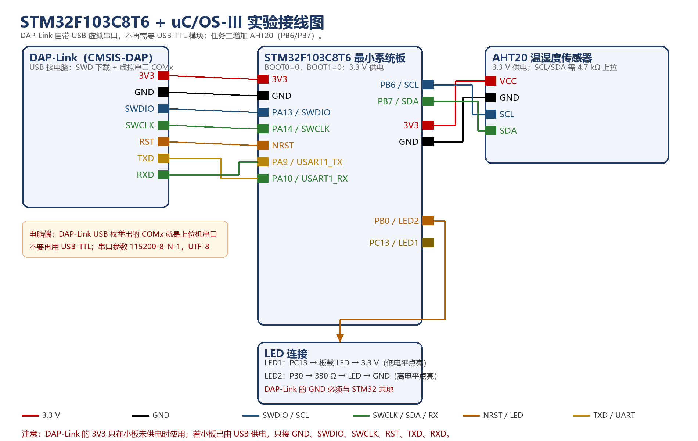

# 任务二：uC/OS-III + 软件 I2C + AHT20 温湿度采集

## 1. 工程文件

用 Keil 5 打开：

```text
Task2_AHT20_RTOS\Task2_AHT20_RTOS.uvprojx
```

本工程在任务一的基础上，把第 3 个任务从“串口 hello”改为“每 2 秒采集一次 AHT20 并通过串口发送”。LED1/1 s、LED2/3 s 两个任务保持不变。

工程已经包含：

- STM32F10x 标准外设库
- CMSIS 与启动文件
- uC/OS-III 3.03.01 源码和 Cortex-M3 移植层
- 软件 I2C 驱动（PB6/PB7）
- AHT20 驱动（含 CRC 校验）
- 三个应用任务

## 2. 硬件连接

### 2.1 器件

- STM32F103C8T6 最小系统板
- DAP-Link（CMSIS-DAP，自带 USB 虚拟串口）
- AHT20 温湿度模块
- LED 2 个、330 Ω 电阻 2 个
- 4.7 kΩ 上拉电阻 2 个（如果 AHT20 模块没有自带上拉）

### 2.2 接线表

| STM32F103C8T6 | 连接到 | 说明 |
|---|---|---|
| 3V3 | DAP-Link 3V3 | 仅在主板没有单独供电时连接 |
| GND | DAP-Link GND | 必须共地 |
| PA13 | DAP-Link SWDIO | SWD 数据 |
| PA14 | DAP-Link SWCLK | SWD 时钟 |
| NRST | DAP-Link RST | 可选，建议接 |
| PA9（USART1_TX） | DAP-Link RXD | 串口交叉：STM32 的 TX 接 DAP 的 RX |
| PA10（USART1_RX） | DAP-Link TXD | 串口交叉：STM32 的 RX 接 DAP 的 TX |
| PC13 | 板载 LED | 低电平点亮 |
| PB0 | 330 Ω → LED → GND | 高电平点亮 |
| PB6 | AHT20 SCL | 软件 I2C 时钟 |
| PB7 | AHT20 SDA | 软件 I2C 数据 |
| 3V3 | AHT20 VCC | 3.3 V 供电 |
| GND | AHT20 GND | 共地 |

AHT20 的 SCL、SDA 需要上拉到 3.3 V：

```text
PB6 ── 4.7 kΩ ── 3.3 V
PB7 ── 4.7 kΩ ── 3.3 V
```

很多 AHT20 模块板上已经带了 10 kΩ 上拉，这种情况下可以不外接；如果串口一直输出 `code=1` 或 `code=2`，优先检查上拉和接线。

完整接线示意：



> 注意：DAP-Link 的 USB 口同时提供 SWD 调试和虚拟串口；电脑端会出现一个 COMx，不需要 USB-TTL。DAP-Link 的 TXD 接 STM32 的 PA10（RX），RXD 接 PA9（TX）。若小板已经由 USB 供电，不要再接 DAP-Link 的 3V3。

## 3. Keil 与 DAP-Link 设置

本工程默认使用 **ARM Compiler 6**（工程文件中的 `uAC6=1`）。如果 Build Output 出现：

```text
Error: C9555E: Failed to check out a license.
```

说明当前选中的 ARM Compiler 5 没有签出 license，不是代码错误。处理办法：

1. `Options for Target` → `Target` → `ARM Compiler` 选择 `Use default compiler version 6`；
2. 或在 `File` → `License Management` 中检查 Keil license 是否有效；
3. 本工程的 `os_cpu_a.s`、`cpu_a.asm`、`lib_mem_a.asm` 已经验证可由 AC6 自带的 `armasm` 汇编。

1. 安装 Keil MDK 5，并在 Pack Installer 中安装 `Keil.STM32F1xx_DFP`。
2. 打开 `Task2_AHT20_RTOS.uvprojx`。
3. `Options for Target` → `Debug`：
   - 选择 `CMSIS-DAP Debugger`；
   - `Settings` → `Port = SW`，`Max Clock = 1 MHz`；
   - 识别不到芯片时选 `under Reset`，或按住复位键再下载。
4. `Utilities` → `Settings`：勾选 `Reset and Run`，确认 Flash 算法。
5. `Build Target`（F7），确认 0 Error。
6. `Download`（F8）。

## 4. 串口上位机

- 波特率：`115200`
- 8 数据位、1 停止位、无校验、无流控
- 编码：`UTF-8`

正常输出示例：

```text
AHT20 温湿度采集任务启动
AHT20: T=25.31 C, RH=48.72 %
AHT20: T=25.33 C, RH=48.80 %
AHT20: T=25.30 C, RH=48.65 %
```

每 2 秒一行。可以用串口助手保存数据，也可以把数据复制到 Excel 画曲线。

## 5. 运行现象

- LED1（PC13）每 1 秒翻转。
- LED2（PB0）每 3 秒翻转。
- 串口每 2 秒输出一行温湿度。
- 用手捂住 AHT20 或对着它哈气，湿度会明显上升，温度缓慢变化。

## 6. AHT20 驱动说明

### 6.1 地址与命令

| 项目 | 值 |
|---|---|
| 7 位地址 | `0x38` |
| 读状态 | `0x71` |
| 校准命令 | `0xBE 0x08 0x00` |
| 触发测量 | `0xAC 0x33 0x00` |
| 测量等待 | ≥ 80 ms |

### 6.2 状态位

- `bit7 = 1`：忙，数据无效；
- `bit3 = 1`：已校准；
- 上电后如果 `bit3 = 0`，先发校准命令，再延时 10 ms。

### 6.3 数据换算

读完 7 字节后：

```c
raw_h = (buf[1] << 12) | (buf[2] << 4) | (buf[3] >> 4);
raw_t = ((buf[3] & 0x0F) << 16) | (buf[4] << 8) | buf[5];

humidity    = raw_h / 1048576.0f * 100.0f;
temperature = raw_t / 1048576.0f * 200.0f - 50.0f;
```

### 6.4 CRC

AHT20 第 7 个字节是 CRC-8：

- 多项式：`0x31`
- 初值：`0xFF`
- 覆盖前 6 个字节

如果模块 CRC 不稳定，可以把 `Drivers/aht20.c` 中的：

```c
#define AHT20_CRC_EN   1u
```

改成 `0u`，先验证温湿度趋势，再查时序和上拉。

## 7. 关键代码位置

| 文件 | 作用 |
|---|---|
| `App/main.c` | BSP 初始化、OSInit、创建启动任务、OSStart |
| `App/app.c` | 三个任务：LED1、LED2、AHT20 采集 |
| `Drivers/i2c_soft.c` | PB6/PB7 软件 I2C：起始、停止、读写、ACK |
| `Drivers/aht20.c` | AHT20 初始化、触发测量、CRC、温湿度换算 |
| `BSP/delay.c` | SysTick 节拍、DWT 微秒延时、OS 毫秒延时 |
| `BSP/uart.c` | USART1 115200 查询发送 |
| `UCOSIII/uCOS_CONFIG/app_cfg.h` | 任务优先级、堆栈大小 |
| `UCOSIII/uCOS_CONFIG/os_cfg_app.h` | OS 节拍 200 Hz |

## 8. 常见问题

### 8.1 串口一直输出 `AHT20 init failed, code=1`

- AHT20 的 VCC/GND 是否接好；
- SCL 是否接 PB6、SDA 是否接 PB7；
- 是否共地；
- 是否加上拉电阻；
- 模块是否是 3.3 V 版本（AHT20 可 2.2–5.5 V 供电，但 I2C 电平要跟 MCU 匹配）。

### 8.2 输出 `code=2`

- 写命令成功，但读数据失败；
- 检查读时序、ACK/NACK、上拉；
- 把 `I2C_DelayUs(5)` 改成 `I2C_DelayUs(10)`，降低速率试试；
- 检查 AHT20 是否在 80 ms 内没有完成测量（可把 80 改成 100 ms）。

### 8.3 输出 `code=4`（CRC 错误）

- 先确认接线和上拉；
- 尝试把 `AHT20_CRC_EN` 改为 0，排除 CRC 代码问题；
- 部分兼容模块的 CRC 字节不稳定，可以关闭 CRC，但课程报告里要说明。

### 8.4 温度或湿度明显不对

- 检查 `raw_h`、`raw_t` 的移位公式；
- 确认读的是 7 个字节，不是 6 个；
- 确认 `buf[0]` 的 bit7 为 0（不忙）；
- 用手哈气看湿度是否上升，判断传感器是否工作。

### 8.5 程序跑飞 / HardFault

- 任务堆栈是否足够（本工程给传感器任务 256 字 = 1 KB）；
- `Uart1_Printf` 的 160 字节缓冲区是否溢出（本工程输出行很短，不会溢出）；
- 是否在中断中调用了 `OSTimeDly` 等阻塞函数；
- 检查 `SysTick_Handler` 是否重复定义。

## 9. 说明

- 本工程使用软件 I2C，不占用 STM32 的硬件 I2C 外设，方便换引脚和移植。
- 软件 I2C 的 SCL 频率约 100 kHz，AHT20 支持标准模式和快速模式。
- 如果课程要求“硬件 I2C”，可以把 `Drivers/i2c_soft.c` 替换为 `stm32f10x_i2c.c` 的初始化与读写函数，AHT20 的命令和数据换算不变。
- uC/OS-III 源码版权归 Weston Embedded / Micrium 所有，本工程仅用于课程学习。
